# PawPal+ AI — Intelligent Pet Care Planning Assistant

PawPal+ AI helps one owner plan a day of care across multiple pets. It finds overlaps including appointment travel, proposes feasible revisions, and asks the owner to approve the resulting schedule.

## Base project

[Module 2 PawPal+](https://github.com/christosam3343/ai110-module2show-pawpal-starter) recorded pets, manually timed tasks, and daily or weekly recurrence. Its Streamlit interface sorted and filtered tasks and reported recorded overlaps. The final project adds a planning loop that can generate, check, and revise proposed care times.

## What the app does

- Create and select pet profiles. Add or edit feeding, walks, appointments, medication reminders, and other care. Complete recurring tasks to create their next occurrence.
- Set a care and travel time budget, daily availability, task priorities, start windows, fixed starts, and appointment travel times.
- Generate a proposal with explanations and a validation trace. Reject it or approve and apply its dates and start times.
- Optionally type an earlier or later timing goal for untimed tasks. A local Qwen model interprets that goal within a closed schema.

## Architecture



[Mermaid source](diagrams/architecture.mmd) · [Design notes](DESIGN.md)

The Streamlit app snapshots the care records due on a selected date, including undated tasks. The planner tries the entered starts and places untimed tasks according to the selected timing preference. An independent validator checks task coverage, bounds, fixed times, travel, budget, and shared-owner overlaps. On failure, CP-SAT searches for a feasible alternative and prioritizes keeping higher-priority tasks near their preferred starts. The validator checks the alternative again. Approval compares the proposal to the live records, revalidates, and applies dates and starts. An infeasible or unverified plan cannot be approved.

The optional Qwen adapter receives only the soft timing phrase. A constrained JSON response selects `earlier`, `later`, `balanced`, or `clarify`. A connection or schema failure uses the selected manual preference and shows the fallback. Task fields remain the authority for dates, start windows, medication times, and travel.

## Install and run

Python **3.14** on Windows PowerShell was used for verification.

```powershell
git clone https://github.com/christosam3343/pawpal-ai-applied-system.git
cd pawpal-ai-applied-system
python -m venv .venv
.\.venv\Scripts\python.exe -m pip install -r requirements.txt
.\.venv\Scripts\python.exe -m streamlit run app.py --server.address=127.0.0.1
```

Open the local URL printed by Streamlit. Select **Load a sample day**, open **Daily planner**, and choose **Generate proposal**. Review the overlap and the explanation, then choose **Reject proposal** or **Approve and apply**. The CLI entry point from Module 2 is still available as `python main.py`.

For macOS or Linux, use `python3.14 -m venv .venv` and substitute `.venv/bin/python` for the Windows interpreter path above.

### Optional local model

Download the CPU build of [llama.cpp b12444](https://github.com/ggml-org/llama.cpp/releases/tag/b12444) and the [Qwen2.5 0.5B Instruct Q4_K_M model](https://huggingface.co/Qwen/Qwen2.5-0.5B-Instruct-GGUF/resolve/9217f5db79a29953eb74d5343926648285ec7e67/qwen2.5-0.5b-instruct-q4_k_m.gguf). The model is approximately 491 MB. Keep the extracted runtime and weights outside tracked files. The following command assumes they are in the ignored `local_data` paths.

```powershell
.\local_data\llama\llama-server.exe --host 127.0.0.1 --port 8089 --alias pawpal-qwen --model .\local_data\qwen2.5-0.5b-instruct-q4_k_m.gguf -c 2048 -t 4 -ngl 0
```

Leave that terminal running while using the local AI field. Enter **Save the flexible activities for the evening.** to test a later preference. Try it with an untimed flexible task. Model SHA-256 is `74a4da8c9fdbcd15bd1f6d01d621410d31c6fc00986f5eb687824e7b93d7a9db`. The standard app and four offline cases run with no model, API key, or paid service.

## Reproducible execution evidence

```powershell
.\.venv\Scripts\python.exe -m pytest -q
.\.venv\Scripts\python.exe evaluate.py
.\.venv\Scripts\python.exe evaluate.py --scenario revised
.\.venv\Scripts\python.exe evaluate.py --with-model
```

The [full recorded run](evidence/scenarios.txt) contains the complete request, decision trace, validation issues, and before/after values for each scenario. These excerpts come from that run.

**Normal day**

```text
Input: Biscuit Walk (30 min; allowed starts 09:00–17:30); Luna Breakfast (15 min; preferred 07:30).
"proposal": [["Breakfast", "07:30", "07:45"], ["Walk", "13:15", "13:45"]]
"initial_issues": [], "final_issues": [], "decision": "approved"
```

**Conflict and revision**

```text
Input: 08:00 walk; confirmed 07:55 medication reminder; 08:30 vet appointment with 30 min travel in each direction.
"proposal": [["Morning walk", "07:25", "07:55"], ["Recorded medication reminder", "07:55", "08:00"], ["Vet appointment", "08:30", "09:00"]]
"trace": ["Input validation passed for 3 tasks.", "Initial candidate validation found 1 issue(s).", "Constraint search returned OPTIMAL.", "Revised candidate passed independent validation.", "Awaiting owner review.", "Owner approved. Revalidation passed and times were applied."]
"unchanged_before_approval": true
```

**Missing medication confirmation**

```text
Input: 08:15 medication reminder with timing confirmation false.
"proposal": []
"final_issues": ["Biscuit (pet 1) / Recorded medication reminder needs a fixed time confirmed against existing veterinary instructions."]
"decision": "blocked"
```

**Live local model**

```text
"timing_goal": "Save the flexible activities for the evening."
"default_starts": ["07:30", "13:15"]
"proposal": [["Breakfast", "07:30", "07:45"], ["Walk", "17:30", "18:00"]]
"trace": ["Input validation passed for 2 tasks.", "Local model selected later for untimed tasks.", "Initial candidate validation found 0 issue(s).", "Awaiting owner review.", "Owner approved. Revalidation passed and times were applied."]
Summary: 5/5 scenarios passed
```

## Reliability and design decisions

- **96 pytest cases passed**, including 49 from Module 2. The expanded suite exercises conflicting appointments, cross-pet overlaps, missing inputs, task priority, unsupported constraints, model failures, stale approval, recurrence, and Streamlit form interactions.
- The harness verified five predefined cases with live Qwen. It also checks that an 08:15 fixed medication reminder during 08:00–09:30 appointment travel makes the day infeasible. The planner fixes the walk only when the entered fixed commitments can coexist.
- The browser walkthrough covered the sample day, first-draft conflict, revised times, rejection, and the applied schedule. [Reproducible test and scenario records](evidence/scenarios.txt) support the demo.
- One owner is a shared resource. Travel consumes time on both sides of an appointment. Priority protects preferred start times and every included task stays required. The solver has a bounded search and can return a verified feasible result without proving optimality.

## Guardrails and limits

Use this tool to organize care. Follow existing veterinary instructions for medication timing and doses. Medication planning requires a confirmed fixed time and medication timing edits need fresh confirmation. The app does not generate doses, clinical instructions, or notifications. It supports one caregiver, one calendar day, manually entered travel, and at most 30 included tasks. Profiles and decisions are held in the Streamlit session. The optional model can misread phrasing, so review its selected timing preference.

The main lesson was to verify a schedule at the point it can affect stored task records. A valid plan can become stale when an owner changes a task, even if it passed the first review.

Future work could add persistent local storage, multi-caregiver planning, real-world usability evaluation, and a broader multilingual timing test set. See the [model card](model_card.md) for failure modes and AI collaboration notes, [presentation guide](presentation/README.md) for the demo, and [project audit](PROJECT_PROGRESS.md) for rubric evidence.

[Public GitHub repository](https://github.com/christosam3343/pawpal-ai-applied-system)
